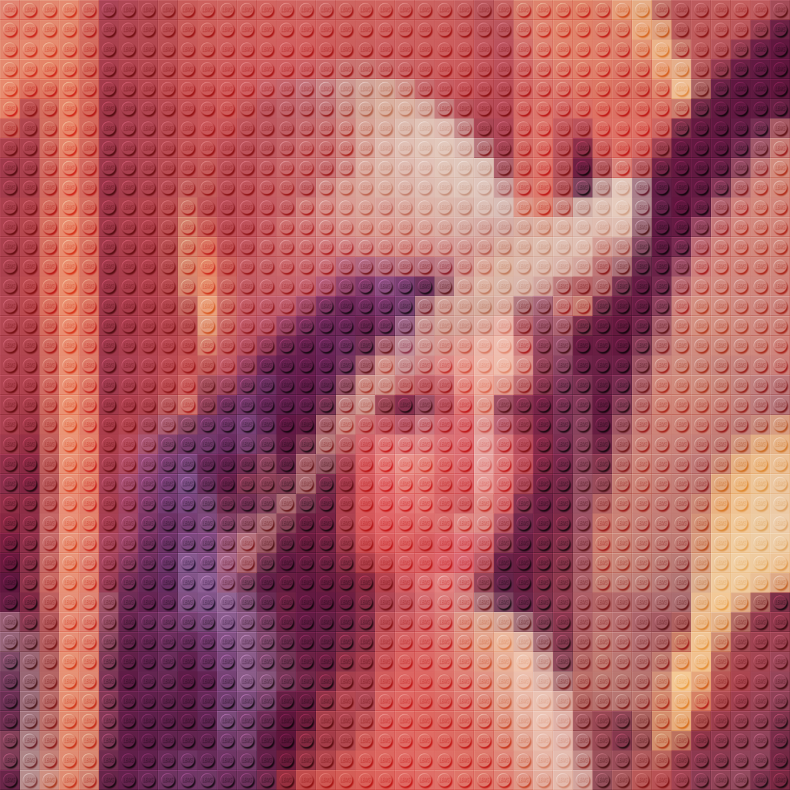
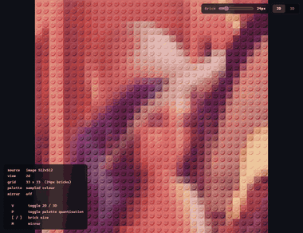

# Brick Mosaic Camera

A live webcam feed rendered as a LEGO brick mosaic, as a fullscreen WebGL shader.



<sub>`lenna.png` at `?cell=24`: 40×40 bricks, sampled colour.</sub>

```bash
npm install
npm run dev
```

Then allow camera access. No camera handy? Point it at any image instead:
`?src=/some-image.png`

The **Brick** slider in the top-right corner sets the brick size live (same as
`?cell=`). Next to it, the **2D / 3D** switch (or the `V` key) flips between
the flat mosaic and a 3D view: the same bricks built as real geometry, with
raised studs, on a slate floating in space that tilts gently toward the mouse.

## Demo



▶ **Full-quality video:** [docs/brick-mosaic-demo.mp4](docs/brick-mosaic-demo.mp4) (H.264, 1040×800, 30 fps, 38 s). The GIF above is the same recording, downscaled, because GitHub doesn't play videos stored in the repository inline.

Recorded against `?src=/reference_images/lenna.png&cell=24&debug`, so the debug HUD is visible bottom-left. **What it shows, in order:**

1. **Brick slider (2D):** dragged down to 12px (a fine 67×67 grid), up to 44px, and back to 24px. The mosaic rebuilds live while dragging.
2. **LEGO palette:** `P` snaps every brick to the nearest real LEGO colour, then `P` again returns to sampled colour.
3. **3D:** the **3D** button turns the same grid into real bricks on a floating slate.
4. **Tilt:** the pointer sweeps to the corners and round the window; the slate eases toward it, and the stud highlights and shadows shift under the fixed light.
5. **Big bricks in 3D:** the slider goes to 64px, the LEGO palette goes back on, and the pointer circles again.
6. **Back to 2D** with the **2D** button.

### UI/UX: how it's built

| Area | Implementation |
| --- | --- |
| **Brick slider** | A native `<input type="range">` (8–96) bound to `config.cellSize`. Each `input` event re-runs `resize()`, which resizes the downsample and cell-colour render targets, so the change is live with no reload. The label shows the size actually in use when the 3D brick budget raises it, e.g. `8→12px`. |
| **Square grid** | N = round(shorter side ÷ brick size). The 2D quad is drawn into a centred square with `renderer.setViewport`, and the rest of the canvas is cleared to the page background. |
| **LEGO palette** | Nearest colour in Oklab over a palette texture, after a 4×4 Bayer dither. The GLSL is shared by the 2D shader and the 3D cell-colour pass, so both views pick the same bricks. |
| **2D / 3D switch** | A two-button group with `aria-pressed`, plus the `V` key. Switching also changes the renderer's output encoding: pass-through for the 2D image filter, sRGB for the lit 3D scene. |
| **3D bricks** | One instanced draw. The vertex shader derives each brick's cell from `gl_InstanceID` and reads its colour from a texture, so there are no instance matrices. Lit with `MeshStandardMaterial` (patched through `onBeforeCompile`), a PCF shadow map for the studs, and the stud lettering as a canvas-drawn bump map. |
| **Tilt** | The pointer position sets a target rotation of up to ±8°, eased with `1 − e^(−4·dt)`. Hovering the controls lets the slate settle flat, and the idle bob is skipped under `prefers-reduced-motion`. |

The still and the video were captured with Playwright driving Chrome against the dev server: the still at a 1760×960 viewport, 1.5× device pixel ratio, clipped to the square mosaic (1440×1440); the video at a 1040×800 viewport through the DevTools screencast.

> `reference_images/` is not committed, so the `?src=` examples below assume you
> have dropped your own images there. The baked brick tile
> (`src/assets/stud-lut.png`) **is** committed, so nothing at runtime depends on
> them — only `npm run bake` does.

## Keyboard

| Key | Action |
| --- | --- |
| `V` | Toggle 2D / 3D |
| `P` | Toggle LEGO palette |
| `[` / `]` | Brick size |
| `M` | Mirror |

## URL flags

| Flag | Default | Meaning |
| --- | --- | --- |
| `?cell=18` | `18` | Brick size in CSS pixels. The grid is always square (N×N bricks), fitted to the shorter window side and letterboxed on the longer one. |
| `?palette=1` | `0` | Snap each brick to the nearest real LEGO colour. |
| `?dither=0.35` | `0.35` | Ordered-dither strength applied before palette matching. |
| `?src=<url>` | — | Use a still image instead of the camera. |
| `?mirror=0` | on for camera, off for images | Horizontal flip. |
| `?view=3d` | `2d` | Start in the 3D view. |
| `?debug` | off | HUD showing source, grid and palette state, plus the shortcut list. |

## How it works

Two passes. The first reduces the source to exactly one texel per brick; the
second draws fullscreen, reading one texel per cell and compositing a brick tile
over it.

The interesting part is that the look was **measured** off
`reference_images/new_yorker.png` rather than approximated:

- The grid is exactly 30px, and the shading tile is **identical in every cell** —
  fixed light direction, no perspective, no per-brick variation. There is no 3D
  in the effect at all.
- The compositing operator is **overlay**, not multiply. Fitting candidates
  across all 1200 reference cells gives RMS error (×255): overlay 0.3,
  soft-light 14.1, linear 14.5, screen 20.4, multiply 44.7. Overlay is the only
  one that compresses the relief at *both* the dark and bright ends, which is
  what the reference does.
- Inverting that blend recovers a single grayscale tile whose flat plate area
  sits at exactly **0.500** — overlay's neutral value — so the plate passes
  brick colour through untouched and only the stud and bevel shade it.

So the whole effect is `overlay(cellColour, tile(cellUV))`, which reconstructs
the reference at **0.27/255 mean** absolute error.

### The 3D view

The 2D look above is a flat image filter; the 3D view is a separate, lit scene
built from the same per-brick colours:

- A third pass resolves each cell to its final brick colour (sampled or
  LEGO-quantised, using the same GLSL as the 2D mosaic), one texel per brick.
- All bricks are **one instanced draw** of a merged body + stud mesh. There are
  no instance matrices: the vertex shader derives each brick's cell from
  `gl_InstanceID` and reads its colour from that texture, so resizing only
  changes a uniform and the instance count.
- The lettering on each stud is a bump map drawn to a canvas at startup and
  mapped onto the stud tops only, so it catches the light like raised text.
  The word and its depth are `studText` / `studTextDepth` in `config.view3d`.
- Lights stay fixed while the slate tilts, so highlights and stud shadows move
  across the bricks. Brick colours are decoded to linear for lighting, so they
  shift slightly from the 2D look, which is expected.
- Real geometry has a budget: past `config.view3d.maxBricks` the 3D grid uses
  larger bricks than the 2D one.

### Two things that are easy to get wrong

**Colour space.** The overlay was fitted on raw sRGB-encoded values, so nothing
in the pipeline may convert to linear — no tone mapping, no output colour-space
conversion, every texture tagged `NoColorSpace`. Deliberately *unlike* the
sibling `night-city-digital-clock` project, whose ACES + sRGB renderer setup is
right for a lit 3D scene and wrong for a 2D image filter. See
[src/core/renderer.js](src/core/renderer.js).

**Averaging.** Each output texel must be the mean over its whole source
footprint. Point-sampling one pixel per cell makes a live feed crawl badly.
See [src/passes/downsample.js](src/passes/downsample.js).

## Tools

```bash
npm run bake     # regenerate src/assets/stud-lut.png from the reference
npm run verify   # golden test: rebuild the reference, assert < 1/255
```

`npm run verify` runs the exact math the fragment shader runs, so it is the
regression guard for the composite — it fails loudly if the blend is changed or
the tile is re-baked wrongly.
